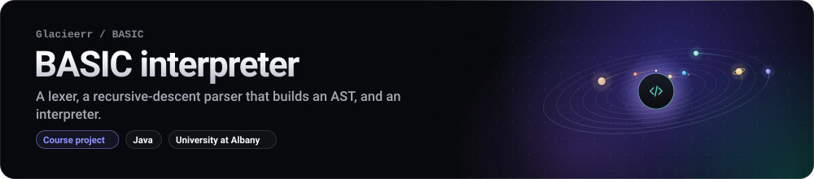

<picture>
  <source media="(prefers-color-scheme: light)" srcset=".github/readme/header-light.svg">
  
</picture>

**A BASIC interpreter in Java: a lexer, a recursive-descent parser that builds an abstract syntax tree (AST), and an interpreter that runs it.**

Course project, Computer Science, University at Albany (SUNY).

## What's inside

| Part | Files |
|---|---|
| Lexer: source text to tokens | `Lexer.java`, `CodeHandler.java`, `Token.java` |
| Parser: tokens to an AST | `Parser.java`, `TokenManager.java` and the `*Node.java` classes (statements, expressions, functions) |
| Interpreter: runs the tree | `Interpreter.java`, `InterpreterDataType.java` |

The language covers PRINT, INPUT, IF, FOR/NEXT, WHILE, GOSUB/RETURN, DATA/READ and END, plus built-in functions such as LEFT$, RIGHT$, MID$, NUM$, VAL and RANDOM.

## How to run

Plain Java: no build tool and no dependencies. The command-line entry point is `Basic.java`: give it a BASIC source file and it prints the tokens the lexer finds.

## Tests

There are no automated tests in this repository.

## Tech stack

Java, standard library only.

<!-- License (R3.3 #162): not chosen yet, so until a LICENSE file is added all rights are reserved.
     Course work: check the school's rules on publishing coursework before choosing.
     When decided, add LICENSE and put this section here, e.g.
## License

[MIT](LICENSE) © 2026 Canyuan Ye
-->

---

中文：课程项目，纽约州立大学奥尔巴尼分校计算机科学。用 Java 实现的 BASIC 语言解释器：词法分析、递归下降语法分析生成抽象语法树（AST）、解释执行。命令行入口是 `Basic.java`，输入一个 BASIC 源文件，打印词法分析得到的记号。仓库里没有自动化测试。
